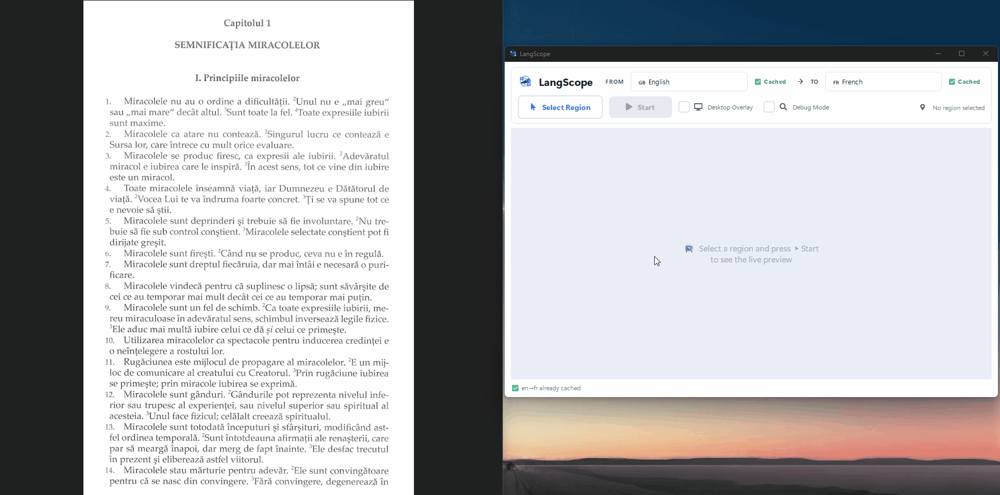

# LangScope

[](https://github.com/MohamedxChaouachi/LangScope/actions/workflows/ci.yml)

Offline live screen translator built with Python and PyQt6.

LangScope continuously captures a region of your screen, runs OCR on it when the content changes, translates the detected text locally with Argos Translate, and draws the translation in place over the original text. It can render inside the app window or as a click-through overlay directly on your desktop.

No internet connection is needed after the initial model downloads. There are no API keys and no cloud services.

---

## How it works

LangScope runs as a small pipeline of threads:

```
CaptureManager (thread, 60 FPS)
      │  latest_frame
      ▼
OCRWorker (QThread, up to 8 FPS, only when the screen changed)
      │  list[RawSegment]
      ▼
TranslationWorker (QThread, on demand)
      │  list[TranslationRegion]
      ▼
Render timer (60 FPS)  →  live feed panel  and/or  desktop overlay
```

1. **Capture.** `CaptureManager` grabs the selected region at up to 60 FPS. It uses DXCam (DXGI desktop duplication) when installed and falls back to MSS. Regions on a secondary monitor are always grabbed with MSS.
2. **OCR.** `OCRWorker` runs EasyOCR at up to 8 FPS, but only when the frame changed. It skips a frame if the frame hash is identical or if fewer than 12 pixels changed noticeably (so a blinking caret or compression noise does not trigger OCR).
3. **Preprocessing.** Before OCR each frame is upscaled 1.5x, converted to grayscale, contrast-enhanced with CLAHE and sharpened. Detections below a 0.35 confidence score are dropped.
4. **Tracking.** `TranslationWorker` matches each detection to an existing region by bounding-box IoU and text similarity. Matched regions keep their identity across OCR passes and their boxes are smoothed with an exponential moving average, so overlays do not jitter.
5. **Translation.** New or changed text is translated in a single batched Argos/CTranslate2 call. Results are cached by text hash, so unchanged text is never translated twice.
6. **Rendering.** Translated text is drawn over the original on a dark background. Font size is matched to the box height, shrunk to fit the width, and word-wrapped if needed.

---

## Features

- In-place translation overlay, positioned at the exact location of the original text
- Two display modes: the in-app live feed, and a click-through, always-on-top desktop overlay
- Fully offline after the first run
- GPU acceleration for EasyOCR (PyTorch CUDA) and for translation (CTranslate2 CUDA, float16), with automatic CPU fallback
- Multi-monitor and mixed-DPI support: the region selector opens on every screen
- Change detection, so OCR and translation do not run on a static screen
- Smart filtering:
  - Skips numbers, timestamps, dates and phone numbers
  - Skips text already in the target language (detected with langdetect)
- Debug mode: shows raw OCR boxes, region IDs, confidence scores, and a stats strip (OCR time split into preprocess and inference, translation time, cache hit rate)
- Live FPS counter
- 11 languages: English, French, Spanish, German, Italian, Portuguese, Romanian, Russian, Chinese, Japanese, Arabic

---

## Requirements

- Python 3.11 or newer
- Windows (tested on Windows 10/11)
- An NVIDIA GPU is optional but recommended

### Installation

Install PyTorch first. The right build depends on your hardware, so it is not one of LangScope's dependencies.

```bash
# CPU only
pip install torch torchvision --index-url https://download.pytorch.org/whl/cpu

# NVIDIA GPU (CUDA 12.1)
pip install torch torchvision --index-url https://download.pytorch.org/whl/cu121

# NVIDIA GPU (CUDA 11.8)
pip install torch torchvision --index-url https://download.pytorch.org/whl/cu118
```

See [pytorch.org](https://pytorch.org/get-started/locally/) for other CUDA versions.

**Newer Python versions.** PyTorch does not publish every CUDA build for every Python version. When this was checked, the CUDA 12.1 build above had no wheels for Python 3.13 or 3.14, and the CUDA 11.8 build had none for 3.14. On those versions, use the CPU build or a newer CUDA build such as `cu126`, `cu128` or `cu130`, for example:

```bash
pip install torch torchvision --index-url https://download.pytorch.org/whl/cu126
```

Then install LangScope itself:

```bash
pip install .
```

To work on it, install it in editable mode together with the test and lint tools:

```bash
pip install -e ".[dev]"
```

Optional, for lower-latency capture on Windows (extras can be combined, as in `".[dev,dxcam]"`):

```bash
pip install ".[dxcam]"
```

---

## Usage

```bash
langscope
```

`python -m langscope` does the same. The `langscope` command is installed into the Python environment you installed LangScope in, so activate that environment first, or call it by path (for example `.venv\Scripts\langscope`).

1. Choose the source (**FROM**) and target (**TO**) languages. If the language pack is not cached yet, it downloads automatically and the badge next to the dropdown shows progress.
2. Click **Select Region** and drag over the area to translate. A selector opens on each monitor. Press `Esc` or right-click to cancel.
3. Click **Start**. The first start loads the OCR and translation models, which can take a few seconds.
4. Optionally enable **Desktop Overlay** to draw translations over the real screen. The overlay is click-through; untick the checkbox to hide it.
5. Optionally enable **Debug Mode** to see OCR boxes, confidence scores and timing stats.

Changing the language pair while running clears tracked regions and caches, then re-translates.

### Configuration

| Setting | Where | Default |
|---|---|---|
| Log level | `LANGSCOPE_LOGLEVEL` environment variable (`DEBUG`, `INFO`, `WARNING`, ...) | `INFO` |
| Translation device | `ARGOS_DEVICE_TYPE` / `ARGOS_COMPUTE_TYPE` environment variables | CUDA if available, else CPU |
| OCR rate | `OCR_FPS` in `src/langscope/ocr_worker.py` | 8 |
| Change-detection sensitivity | `PIXEL_DELTA`, `MIN_CHANGED_PX` in `src/langscope/ocr_worker.py` | 40, 12 |
| OCR preprocessing and confidence | `PreprocessConfig` in `src/langscope/ocr_providers.py` | upscale 1.5x, grayscale, CLAHE, sharpen, confidence 0.35 |
| Region tracking and smoothing | constants at the top of `src/langscope/translation_worker.py` (`IOU_THRESHOLD`, `TEXT_SIM_THRESHOLD`, `EMA_ALPHA`, `MAX_MISSES`, `REGION_TTL`) | see file |

An unknown value for `LANGSCOPE_LOGLEVEL` means `INFO`.

Example, for verbose logs:

```powershell
$env:LANGSCOPE_LOGLEVEL = "DEBUG"; langscope
```

---

## Project structure

```
LangScope/
├── src/langscope/
│   ├── main.py                  # Entry point: reads the config, sets up logging and the backends, runs the app
│   ├── __main__.py              # `python -m langscope`
│   ├── controller.py            # AppController: wires the panel to the pipeline and owns its lifecycle
│   ├── config.py                # The log level, from LANGSCOPE_LOGLEVEL
│   ├── capture_manager.py       # 60 FPS screen capture thread (DXCam, MSS fallback)
│   ├── ocr_worker.py            # OCR thread; FrameChangeGate decides whether a frame is worth OCR
│   ├── ocr_providers.py         # BaseOCR interface, EasyOCR provider, preprocessing pipeline
│   ├── translation_worker.py    # Region tracking, bbox smoothing, filtering, batched translation
│   ├── translation_providers.py # BaseTranslator and LanguagePacks interfaces, with Argos implementations
│   ├── translator.py            # Argos Translate setup, device configuration, language packs, batched translation
│   ├── models.py                # RawSegment, TranslationRegion, RegionSnapshot, and the BBox and Region types
│   ├── render_gate.py           # Decides what the 60 FPS render timer needs to redraw
│   ├── ui.py                    # Control panel, live feed widget, multi-monitor region selector
│   ├── overlay_window.py        # Click-through desktop overlay
│   ├── render_utils.py          # Shared text-drawing code for the live feed and overlay
│   ├── screen_utils.py          # Native/logical pixel conversion for multi-monitor and HiDPI
│   ├── theme.py                 # UI colors, fonts and spacing
│   └── assets/                  # App icon and UI images (shipped as package data)
├── scripts/
│   ├── bench_ocr.py             # OCR benchmark harness
│   └── check_wheel.py           # Checks that a built wheel has its assets and entry point (used by CI)
├── tests/                       # pytest suite
├── .github/workflows/           # CI: ruff, wheel build and check, pytest, pyright
├── pyproject.toml               # Packaging metadata, dependencies and tool configuration
├── requirements-ci.txt          # The lightweight set CI installs (no torch, easyocr or argostranslate)
└── LICENSE                      # MIT
```

`BaseOCR` and `BaseTranslator` are the extension points: add a new engine by implementing the interface, without touching the rest of the pipeline.

---

## Dependencies

| Package | Purpose |
|---|---|
| PyQt6 | UI framework |
| qtawesome | UI icons |
| easyocr (with PyTorch) | OCR, optional CUDA acceleration |
| argostranslate | Offline neural machine translation (CTranslate2) |
| langdetect | Language identification |
| mss | Screen capture (fallback and secondary monitors) |
| numpy | Frame processing |
| dxcam (optional) | Faster capture on the primary monitor |

OpenCV (`opencv-python-headless`, imported as `cv2`) is used for preprocessing. The `argostranslate` range is bounded on both sides (`>=1.10.0,<1.12`) because `translator.py` reads some of Argos' internals to translate in batches; `tests/test_argos_contract.py` checks them.

---

## Development

Create and activate a virtual environment, then install the development extra. Install the CPU or CUDA PyTorch build first as described in [Installation](#installation), because PyTorch uses a custom package index.

```powershell
python -m venv .venv
.\.venv\Scripts\Activate.ps1
pip install -e ".[dev]"
```

Run the checks from the activated environment:

```powershell
ruff check .
ruff format --check .
pytest
pyright
```

For the lightweight test-only environment used by CI, install `requirements-ci.txt` instead; it omits PyTorch, EasyOCR and Argos Translate. Tests that require Argos skip with a reason when it is not installed.

The tests cover region tracking, change detection, batched translation (including pivoting through English), coordinate conversions, the region selector, controller wiring, startup configuration and packaging. Smoke tests import every module and build and paint the Qt widgets offscreen, so no display is needed.

CI runs Ruff, builds and checks the wheel, then runs pytest and Pyright on Windows with Python 3.11 and 3.14 ([workflow](.github/workflows/ci.yml)).

---

## Benchmark

OCR inference (EasyOCR's CRAFT detector and CRNN recognizer) is the dominant cost per frame, not the threading pipeline. On GPU, recognition runs in batches of 16 boxes and halves the batch size automatically if the card runs out of VRAM. The debug stats strip shows the live preprocess/inference split.

Fill in this table with the output from the commands below. Use the same screen region for each run; the first model load and warm-up are excluded from the timing samples.

| Device | Language | Region | Preprocess mean / median / p95 (ms) | Inference mean / median / p95 (ms) | Total mean / median / p95 (ms) | Sustained FPS |
|---|---|---|---:|---:|---:|---:|
| CPU | en | 600 x 300 | — / — / — | — / — / — | — / — / — | — |
| CUDA, FP32 | en | 600 x 300 | — / — / — | — / — / — | — / — / — | — |
| CUDA, FP16 (experimental) | en | 600 x 300 | — / — / — | — / — / — | — / — / — | — |

Run these commands in PowerShell from the repository root with the project environment active. The selected rectangle must fit on a connected monitor.

```powershell
# CPU: hide CUDA from PyTorch for this process.
$env:CUDA_VISIBLE_DEVICES = ""; .\.venv\Scripts\python.exe scripts\bench_ocr.py --frames 40 --lang en --top 100 --left 100 --width 600 --height 300

# CUDA FP32: remove the override so PyTorch can select the GPU.
Remove-Item Env:CUDA_VISIBLE_DEVICES -ErrorAction SilentlyContinue; .\.venv\Scripts\python.exe scripts\bench_ocr.py --frames 40 --lang en --top 100 --left 100 --width 600 --height 300

# CUDA FP16: experimental; use only after the FP32 run succeeds.
Remove-Item Env:CUDA_VISIBLE_DEVICES -ErrorAction SilentlyContinue; .\.venv\Scripts\python.exe scripts\bench_ocr.py --frames 40 --lang en --top 100 --left 100 --width 600 --height 300 --fp16
```

The harness reports preprocess, inference and total mean/median/p95 latency, plus effective maximum sustained FPS. FP16 is opt-in and may fail with a dtype mismatch in EasyOCR; the benchmark does not change the app's default, which remains FP32.

---

## Design decisions & trade-offs

- **Polling instead of per-frame signals.** Capture and translation workers replace their latest-frame and immutable-region snapshots. The 60 FPS render timer polls those references and redraws only when either changes. This avoids queuing high-rate signals and copying or repainting identical frames, at the cost of intentionally skipping intermediate states when workers run faster than rendering.
- **Pixel-count change detection.** The OCR gate compares every other pixel in each dimension and counts sampled pixels whose largest channel difference exceeds 40. At least 12 sampled pixels must change. This ignores small compression changes and blinking cursors, while a changed text line affects enough pixels to trigger OCR. Tiny or low-contrast changes can be missed.
- **IoU plus text similarity.** Region matching requires IoU of at least 0.30 and scores candidates with 60% overlap and 40% text similarity; the combined score must reach the configured threshold. Position alone can merge neighboring lines, while text alone can confuse repeated words, so both contribute to identity tracking.
- **EMA box smoothing.** Bounding boxes use an exponential moving average with `EMA_ALPHA = 0.35`. This reduces jitter between OCR passes but makes the overlay follow rapid movement with a little lag.
- **Batched CTranslate2 translation.** Sentences from multiple lines are grouped into model batches, preserving alignment and reducing per-call overhead. Argos pivot pairs can require two batched hops. The implementation reads Argos internals for this path, so the dependency is version-bounded and covered by a contract test.
- **EasyOCR and Argos.** Both keep recognition and translation local after their models and language packs are downloaded. EasyOCR covers the supported scripts through pretrained models; Argos supplies offline language packs and CTranslate2 inference. The trade-offs are a substantial PyTorch install, model-download/storage requirements, CPU latency, and the need to monitor Argos internals as it evolves.

---

## Known limitations

- Windows is the supported and tested desktop platform. Capture behavior on other operating systems is not verified.
- OCR is gated by pixel changes, so very small changes can wait until enough pixels differ. The OCR worker is capped at 8 passes per second, and CPU-only inference can be slow; smaller capture regions help.
- Regions are selected on one monitor at a time; a capture region cannot span monitors. Secondary-monitor capture uses MSS rather than DXCam.
- EasyOCR and Argos models/packs download on first use and require local disk space. Argos language packs are commonly around 100 MB each; OCR models can be around 200 MB for Latin-script languages.
- **Region pruning is incomplete while OCR batches keep arriving.** `_prune()` currently runs only when the worker mailbox is idle. If batches arrive continuously, regions missed beyond `MAX_MISSES` can remain tracked and the tracking work can grow. The strict expected-failure test is `test_dead_regions_are_removed_while_batches_keep_arriving` in `tests/test_translation_tracking.py`.
- FP16 OCR is experimental and disabled by default; EasyOCR may encounter a dtype mismatch on some configurations.

---

## Notes

- Argos language packs (~100 MB each) are downloaded once and cached under `~/.local/share/argos-translate/`. For pairs without a direct pack, Argos pivots through English (for example Romanian to French goes through Romanian to English to French).
- EasyOCR models are downloaded once on first use (~200 MB for Latin-script languages). Russian, Chinese, Japanese and Arabic each use their own model.
- Latin-script languages are loaded together with the English model so accented characters and plain ASCII are both recognized.
- The first translation after startup or a language change includes a one-time model warm-up.

---

## Roadmap

- Additional OCR and translation engines behind the existing `BaseOCR` / `BaseTranslator` interfaces
- Non-Windows support
- Prebuilt Windows release
